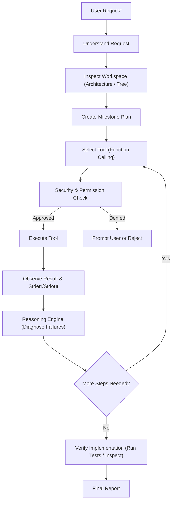

# FIXEN CODE — Architecture Documentation

## 1. Architectural Overview

FIXEN CODE follows a modular, decoupled engine design:

```
+-------------------------------------------------------------------+
|                         FIXEN CLI (`bin/fixen.js`)                |
|               (Argument Parsing, Banner, REPL, Commands)           |
+-------------------------------------------------------------------+
                                  |
                                  v
+-------------------------------------------------------------------+
|                         AGENT ORCHESTRATOR                        |
|                                                                   |
|   +--------------------+  +--------------------+  +-------------+ |
|   |  Planning Engine   |  |  Reasoning Engine  |  | Context Mgr | |
|   +--------------------+  +--------------------+  +-------------+ |
|   +--------------------+  +--------------------+  +-------------+ |
|   |  Autonomous Loop   |  |   Session Store    |  | Permissions | |
|   +--------------------+  +--------------------+  +-------------+ |
+-------------------------------------------------------------------+
                                  |
       +--------------------------+--------------------------+
       |                          |                          |
       v                          v                          v
+---------------+        +------------------+        +---------------+
| LLM Providers |        |  Tools Registry  |        | Intelligence  |
| - Groq        |        | - File Tools     |        | - Scanner     |
| - OpenAI      |        | - Terminal Tools |        | - Detector    |
| - Gemini      |        | - Git Tools      |        | - Analyzer    |
| - Ollama      |        | - Custom Plugins |        +---------------+
+---------------+        +------------------+                |
                                  |                          |
                                  v                          v
                       +----------------------+    +-----------------+
                       | Security / PathGuard |    |  Target Project |
                       | - Traversal Guard    |    |    Workspace    |
                       | - Secret Masker      |    +-----------------+
                       | - Audit Logger       |
                       +----------------------+
```

---

## 2. Autonomous Agent Lifecycle



---

## 3. Core Subsystems

### 3.1 LLM Provider Engine (`src/providers/`)
- Implements an OpenAI-compatible function-calling protocol.
- **GroqProvider**:
  - Endpoint: `https://api.groq.com/openai/v1`
  - Default Model: `llama-3.3-70b-versatile`
  - Automatic exponential backoff retry on HTTP 429 (rate-limit) and 5xx errors.
  - AbortController request timeouts.
  - Token tracking (`prompt_tokens`, `completion_tokens`, `total_tokens`).

### 3.2 Security & Permission Engine (`src/security/`)
- **PathGuard**: Enforces strict workspace boundary. Uses `path.resolve()` and `path.relative()`. Rejects `..` traversal and symlink escapes.
- **SecretGuard**: Regex-based redaction of API keys (Groq, OpenAI, GitHub, JWT, passwords).
- **AuditLogger**: Appends timestamped execution events to `.fixen/audit.log`.
- **5 Permission Levels**:
  - `1`: READ_ONLY
  - `2`: ASK_BEFORE_CHANGES
  - `3`: ASK_BEFORE_COMMANDS
  - `4`: CONTROLLED_AUTO (Default)
  - `5`: FULL_AUTO (Requires `--full-auto`)

### 3.3 File System Engine (`src/tools/file-tools.js`)
- Atomic file writes via temporary files (`${file}.tmp.${Date.now()}`) to prevent partial writes.
- Automatic snapshot backups into `.fixen/backups/` before overwriting or deleting.
- Unified diff computation (`src/utils/diff.js`) for review before file modifications.

### 3.4 Terminal Execution Engine (`src/terminal/`)
- Cross-platform shell detection:
  - Windows: PowerShell (`-NoProfile -NonInteractive -ExecutionPolicy Bypass -Command "& { cmd }; exit $LASTEXITCODE"`) or CMD.
  - POSIX: `/bin/bash` or `sh`.
  - Android Termux: `/data/data/com.termux/files/usr/bin/bash`.
- Dangerous command regex filtering.
- Configurable process timeouts with taskkill (Windows) and SIGKILL (POSIX).

### 3.5 Codebase Intelligence (`src/intelligence/`)
- **ProjectScanner**: Recursive scan, ignoring `node_modules`, `.git`, `dist`, `.fixen`, and `.gitignore` patterns. Builds ASCII file trees.
- **ProjectDetector**: Maps file extensions and package manifests to languages, frameworks, package managers, and test runners.
- **ProjectAnalyzer**: Produces markdown architectural summaries injected into the LLM system prompt.
